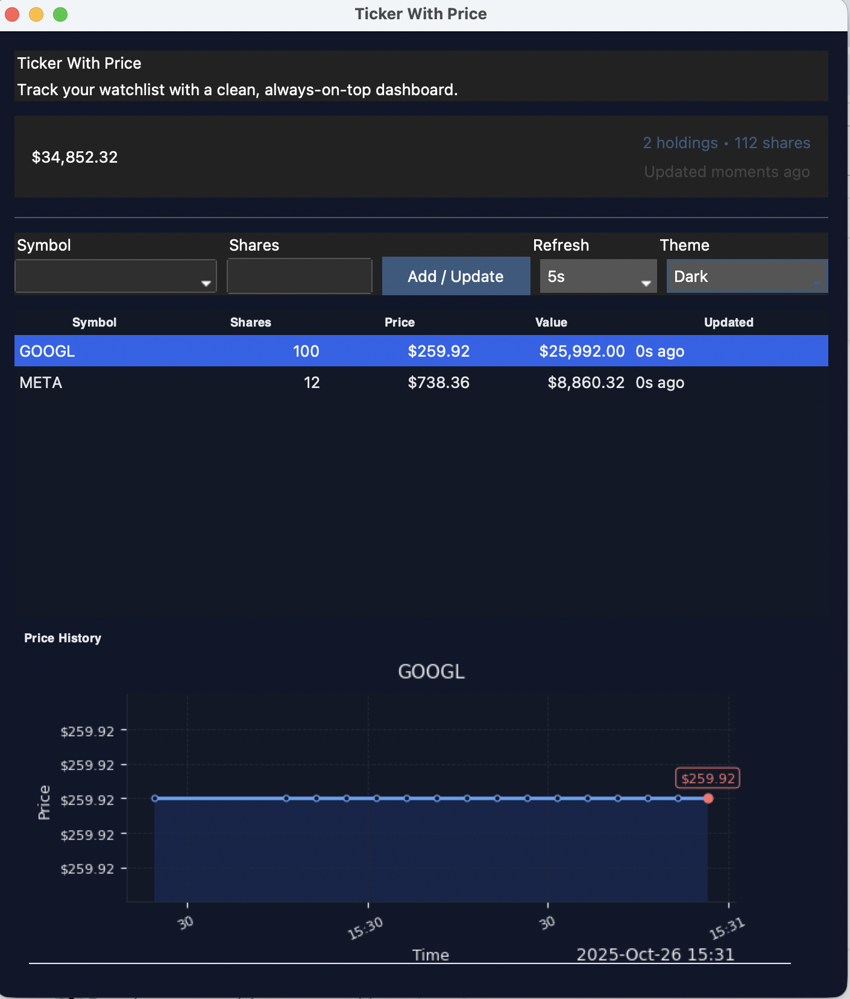

# Ticker With Price

[](https://buymeacoffee.com/redbasecap)

A small Tkinter desktop ticker that keeps your stock holdings up to date using Yahoo Finance data.

# Screenshots



## Install

Make sure you have Python 3.9+ available, then run:

```bash
python install.py
```

The script creates a dedicated `.venv` virtual environment, installs the required packages (`requests`, `matplotlib`, and `ttkbootstrap`), and drops a `.env` template you can use for future configuration.

## Run

macOS / Linux:

```bash
./.venv/bin/python ticker.py
```

Windows (PowerShell):

```powershell
.\.venv\Scripts\python.exe ticker.py
```

Add or update your symbols, set share counts, and the app will keep prices refreshed in the background. The window stays on top so you can keep an eye on your positions while you work.
